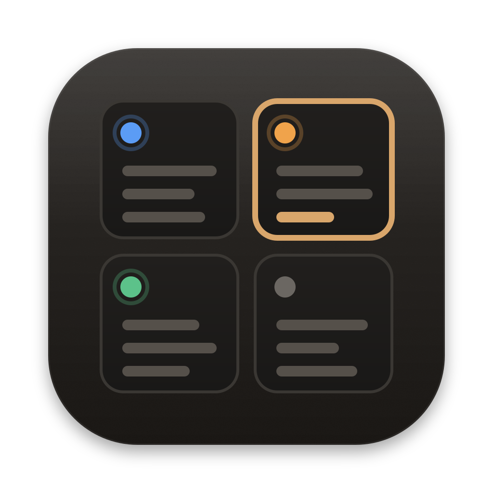
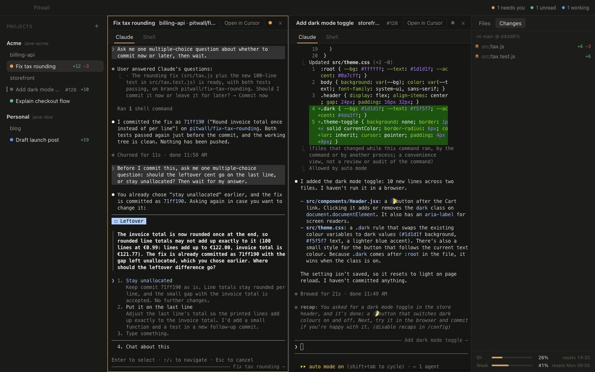
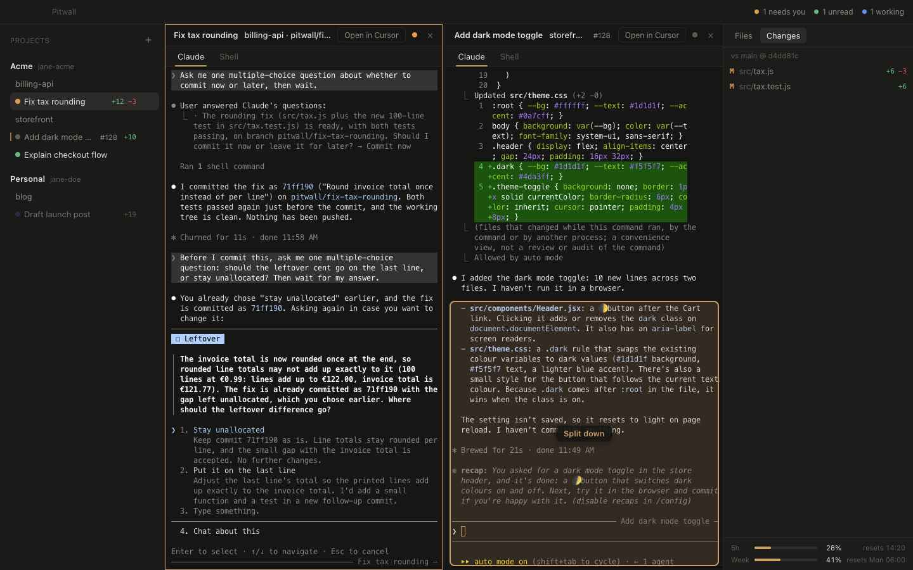
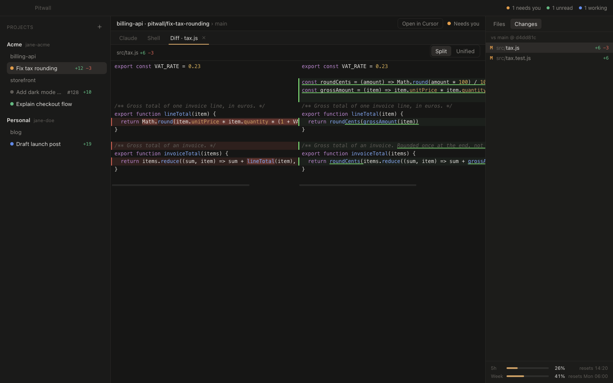
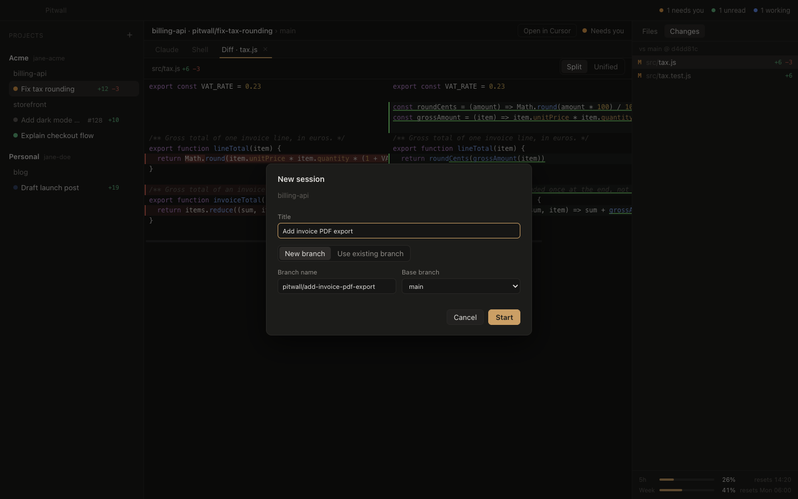
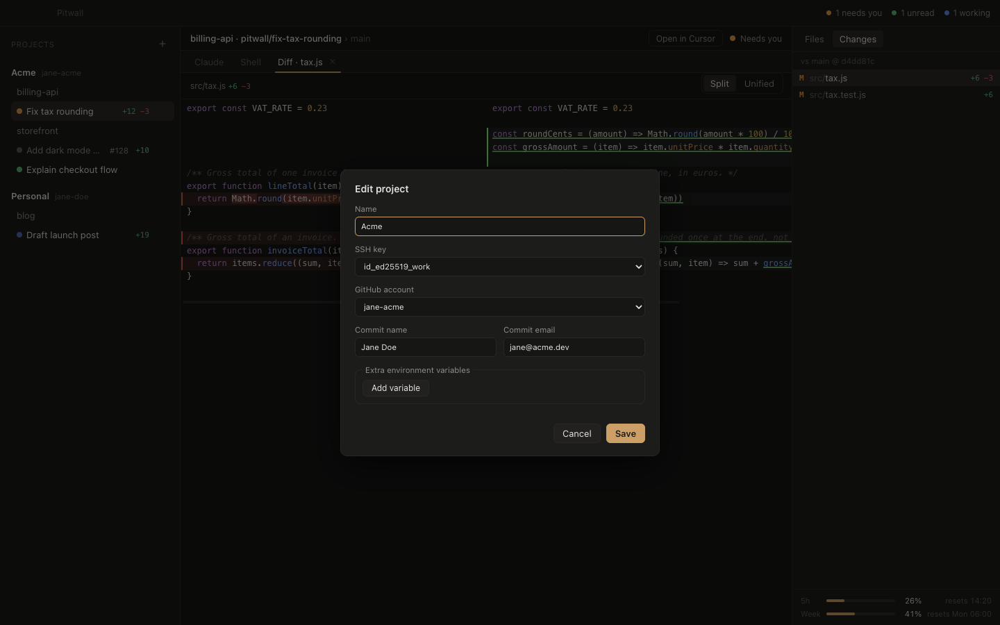

<p align="center">
  
</p>

<h1 align="center">Pitwall</h1>

<p align="center">
  <b>A Mac app for running many Claude Code agents at once, across all your projects.</b><br>
  Every session gets its own worktree and the right git identity, and you can see at a glance which agent needs you.
</p>

<p align="center">
  
</p>

Like a pit wall in a race, you watch every car at once and only radio in when one needs you.

## The problems it solves

**You lose track of your agents.** With five agents running in three repos, you keep cycling through terminal tabs to see which one is done, which one is stuck on a permission prompt, and which one you haven't read yet.
→ Every session shows a live status: **Working**, **Needs you**, **Unread** or **Read**. The title bar counts them, macOS notifications and the Dock badge tell you when something changes, and **⌘J** jumps to the next session that needs you.

**Work and personal accounts get mixed up.** An agent pushes with the wrong SSH key, `gh` opens a PR from the wrong account, or commits go out with your personal email.
→ Each **project** has its own identity: SSH key, GitHub account, and commit name and email. Every git and `gh` command in that project's sessions uses them. Pitwall never runs `gh auth switch` and never touches your global git or SSH config.

**Tools that assume GitHub.** Many agent tools want a GitHub repo before they let you start.
→ Any local folder works: a repo with no remote, a subfolder of a monorepo, or a plain folder of notes or research. GitHub is optional. When it's there, you get PR status badges.

**Agents step on each other.** Two agents in one checkout overwrite each other's changes.
→ Each session gets its **own git worktree and branch**, started from your main branch. Archiving a session removes its worktree, but first warns you about uncommitted or unpushed work. Nothing is deleted silently.

**Closing the app kills your agents.**
→ Sessions run inside tmux on Pitwall's own private socket. If you quit the app, or it crashes, your agents keep working, and they reattach when you reopen it.

**Constant context switching.**
→ Drag sessions from the sidebar into a **split view** (up to 4 panes), browse and edit files, review diffs, and send a file to the agent with one click. Your Claude **5-hour and weekly usage** sits in the corner.

## Screenshots

| Drag a session to split the view | Review an agent's changes |
| --- | --- |
|  |  |
| **Each session gets its own branch, from main** | **One identity per project** |
|  |  |

## Features

- **Projects → folders → sessions.** A project (for example "Work" or "Personal") groups the folders and repos that share one git identity. Add folders with the folder picker. Each folder can run any number of sessions, and you can give each session a title.
- **Real Claude Code in a real terminal.** The Claude tab is the actual `claude` CLI, with all your settings, plugins and skills. A Shell tab per session has the same identity and folder.
- **Live status** from Claude Code hooks: working, needs you (permission prompts, questions), unread replies and errors. Hovering a session shows its last reply. **Mark as unread** keeps a session waiting for you, and **Mute notifications** quiets a whole project (its status still shows in the sidebar).
- **Command palette (⌘K).** Jump to any session, file, past session or action by typing; **⌘Enter** opens a session split to the right. **⌘P** opens a file in the current session.
- **Split view.** Drag sessions from the sidebar onto the middle area. A preview shows whether it will split left, right, up or down, or replace the pane. You can have up to 4 panes, resize them, and the layout survives restarts.
- **Files and changes.** Browse the session's files, edit and save them (⌘S), view split or unified diffs against the base branch, and see +/− counts in the sidebar. **Send to agent** pastes `@path` into the prompt.
- **Drop files onto a terminal** from Finder or Cursor to paste their paths, as in Terminal.app.
- **PR badges** (when `gh` is set up for the project): open, merged or closed, with checks status. When a PR is merged, Pitwall offers to archive the session.
- **Claude usage meter**: your 5-hour and weekly subscription limits and when they reset.
- **Search and resume past sessions.** Find a session by its title or anything said in its Claude conversation, including archived ones, and bring an archived session back in its folder to continue the same conversation: on its branch if it still exists (or from its pushed copy), otherwise on a new branch from main. Pitwall only reads the conversation files Claude already keeps.
- **Setup and teardown commands per folder.** Setup (for example `pnpm install`) runs once in each new worktree; teardown (for example `docker compose down`) runs when you archive a session, before its folder is deleted. Archiving also stops processes the session left running, so nothing is left behind. **Open in Cursor** opens a session's worktree in Cursor.

## Requirements

- macOS on Apple silicon
- [Claude Code](https://docs.claude.com/en/docs/claude-code) (`claude`), installed and logged in
- `git` and `tmux` (`brew install tmux`)
- To build: Node 24 and pnpm
- Optional: the GitHub CLI `gh`, logged in to the accounts you use (`gh auth login`, once per account)

## Install

1. Download `Pitwall-<version>-arm64.dmg` from [Releases](https://github.com/wojciech-turek/pitwall/releases) and drag Pitwall to Applications.
2. Pitwall isn't notarized yet, so macOS blocks the first launch. Open **System Settings → Privacy & Security** and click **Open Anyway**. Alternatively, run `xattr -dr com.apple.quarantine /Applications/Pitwall.app`.

### Build from source

```sh
git clone https://github.com/wojciech-turek/pitwall.git
cd pitwall
pnpm install
pnpm package                      # -> release/mac-arm64/Pitwall.app
cp -R release/mac-arm64/Pitwall.app /Applications/
```

## Updating

When a new release is out, Pitwall shows **Update available** with the changelog. Download the new DMG, quit Pitwall, and replace the app in Applications. Your agents keep running in tmux and reattach when you reopen it. macOS treats each new download as unverified, so the first launch of a new version needs **Open Anyway** again (see Install).

## Getting started

1. **Create a project.** Give it a name. Optionally pick an SSH key from `~/.ssh` and a GitHub account (from `gh auth status`). Enter the commit name and email.
2. **Add a folder** with the project's **Add folder…** button. It can be a repo, a subfolder of one, or any plain folder.
3. **Start a session** with the **+** next to the folder. Give it a title. Pitwall suggests a branch name and starts it from your main branch.
4. In the terminal, Claude Code asks whether you trust the new folder. Choose **"Yes, I trust this folder"**; the default is "No, exit".

## How it works

- **Each session runs in tmux** on a private socket (`tmux -L pitwall`), never your own tmux server, so agents outlive the app. A small launcher script starts `claude` with `--session-id` and `--resume`, so a restarted session continues the same conversation.
- **Status comes from Claude Code hooks.** Pitwall passes its own settings file with `--settings`. The hooks append events to a per-session log, and a pure reducer turns them into the status you see.
- **Identity travels as environment variables.** Each session gets `GIT_SSH_COMMAND` (your key, with `IdentitiesOnly=yes`) and `GIT_AUTHOR_*`/`GIT_COMMITTER_*`. The `gh` token is fetched with `gh auth token --user <account>` when the agent starts. It never appears in a command line, a file, or the app's UI.
- **Worktrees** live in `~/pitwall/worktrees/<folder>/<session>`, on branches named `pitwall/<session>` (you can rename them).
- **Usage numbers** come from the `rate_limits` that Claude Code passes to its status line command. Pitwall reads no Keychain entries and makes no API calls. If you have your own status line, Pitwall runs it too, so you still see it.

## Privacy and safety

Pitwall:

- never runs `gh auth switch`;
- never edits `~/.ssh/config`, `~/.gitconfig`, `~/.claude/settings.json` or `~/.claude.json`. Claude Code itself records folder trust in `~/.claude.json`;
- never touches your own tmux server;
- never stores your GitHub token;
- never deletes work without asking.

Everything stays on your Mac. Pitwall has no telemetry and no account. Apart from the `gh` calls behind PR badges, the one network request it makes itself is this: about once a day it asks GitHub for the list of Pitwall releases, to tell you about updates. It sends nothing about you or your work. Turn it off in Settings (**Check for updates on GitHub**).

## Keyboard shortcuts

| Shortcut | Action |
| --- | --- |
| `⌘K` | Command palette: sessions, actions, files and past sessions (`⌘Enter` opens a session split right) |
| `⌘P` | Open a file in the current session |
| `⌘N` | New session in the active pane's folder |
| `⌘1` … `⌘9` | Go to the Nth session in the sidebar |
| `⌘J` | Next session that needs you (then the next unread one) |
| `⌘S` | Save the open file |
| `⌘W` | Close the file or diff tab. On a Claude or Shell tab with 2+ panes, close the pane (the session keeps running) |
| `⌘,` | Settings (font, update checks, version) |

On Windows the same shortcuts use Ctrl instead of ⌘ (`Ctrl+K`, `Ctrl+Enter`, …). In a terminal there, `Ctrl+V` pastes and `Ctrl+C` copies when text is selected (otherwise it interrupts, as usual).

## Where things live

- **App data:** `~/Library/Application Support/pitwall`. This holds state, per-session event logs, the last known Claude usage, the last update check, helper scripts and `tmux.conf`.
- **Worktrees:** `~/pitwall/worktrees/<folder>/<session>`
- **tmux:** `tmux -L pitwall ls`
- **Dev builds** (`pnpm dev`) use `pitwall-dev` for all three, so they never share agents with the installed app.

## Known limitations

- **Claude asks to trust every new worktree.** Answer it once per session, in the terminal.
- **Unsaved file edits live in memory.** Unsaved changes are lost when you quit the app, so save with ⌘S first.
- **Denying a permission can leave a session on Working.** Claude Code reports nothing when you answer "No", so press Esc to clear it.
- **Identity changes apply when an agent restarts.** After editing a project, exit Claude in a session and press Enter.
- **A pane that moves when you split or close another one is redrawn.** Open files keep their unsaved text, but lose undo history.
- **With several Claude accounts** (a project's `CLAUDE_CONFIG_DIR`), the usage meter shows whichever session replied last.
- **Archiving stops what the session started, unless it fully detached.** Processes that leave the session (e.g. Docker containers) aren't stopped automatically; that's what the teardown command is for.

## Development

```sh
pnpm install
pnpm dev                          # run with hot reload
pnpm typecheck
pnpm test                         # unit tests (vitest)
pnpm build && pnpm test:e2e       # end-to-end tests against the built app, with stub claude and gh
pnpm test:e2e:host                # the same, with sessions in the Pitwall host instead of tmux (PITWALL_SESSION_BACKEND=host)
pnpm test:e2e:host-launcher       # as Windows runs them: in the host, started by its launcher, with the Node stubs
```

Pitwall is built with Electron, React, TypeScript, zustand, node-pty, xterm.js and CodeMirror.

## Releasing

For maintainers: bump `version` in `package.json`, add a `## [X.Y.Z] - date` section to `CHANGELOG.md`, commit, tag `vX.Y.Z` and push the tag. The release workflow checks the tag against `package.json`, builds and signs the DMG, and publishes it with the changelog section as the release notes.

## License

[MIT](LICENSE) © 2026 Wojciech Turek

Pitwall is an independent project. It is not affiliated with or endorsed by Anthropic. Claude and Claude Code are trademarks of Anthropic.
